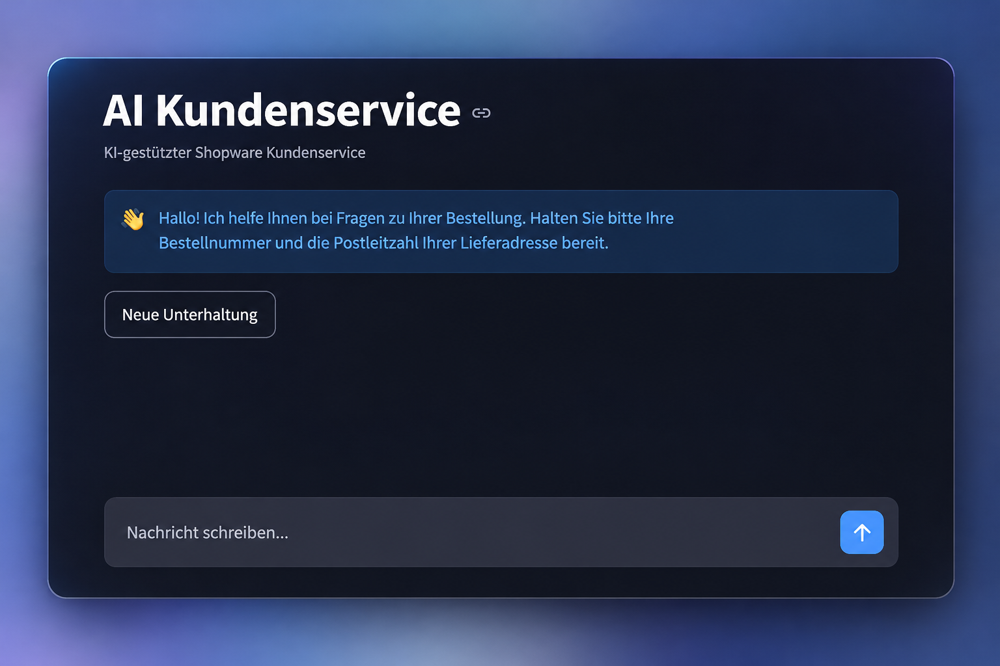
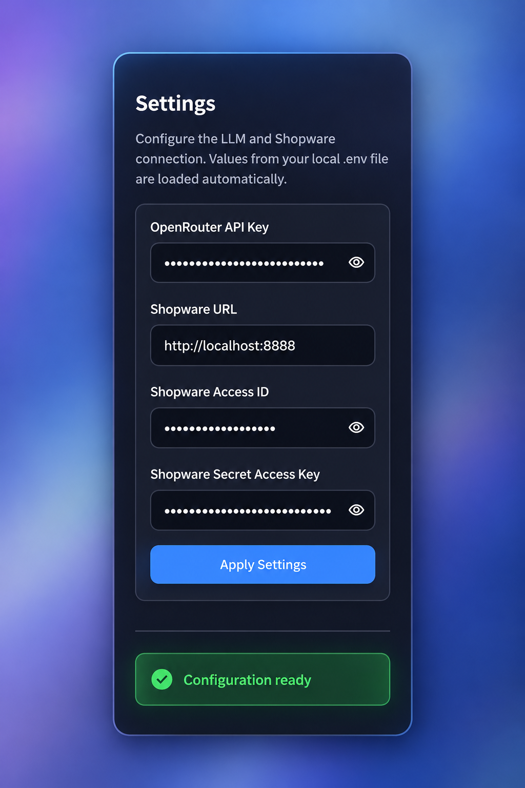

# Shopware AI Support Agent

An AI-powered customer support assistant for Shopware 6.

The assistant understands natural-language customer requests and uses tool calling to retrieve real-time order data from Shopware.

<h2>Demo</h2>

<table>
  <tr>
    <td width="68%" align="center">
      <strong>Customer Interface</strong>
    </td>
    <td width="32%" align="center">
      <strong>Configuration</strong>
    </td>
  </tr>
  <tr>
    <td align="center" valign="top">
      
    </td>
    <td align="center" valign="top">
      
    </td>
  </tr>
</table>

## How it works

1. The customer sends a natural-language question.
2. The LLM determines whether Shopware data is required.
3. The LLM requests the appropriate backend tool.
4. The backend verifies the order number and shipping ZIP code.
5. The backend retrieves the order data through the Shopware Admin API.
6. Only verified order data is returned to the LLM.
7. The LLM generates a customer-friendly response based on that data.

## Tech Stack

- Python
- OpenRouter / LLM
- LLM Tool Calling
- Shopware 6 Admin API
- Streamlit

## Getting Started

### 1. Clone the repository

```bash
git clone https://github.com/MiladGhanei/shopware-ai-support-agent.git
cd shopware-ai-support-agent
```

### 2. Create a virtual environment

```bash
python -m venv .venv
source .venv/bin/activate
```

### 3. Install dependencies

```bash
pip install -r requirements.txt
```

### 4. Configure the application

Copy the example environment file:

```bash
cp .env.example .env
```

Add your OpenRouter and Shopware API credentials to `.env`.

Alternatively, the credentials can be configured directly in the application's Settings sidebar.

### 5. Start the application

```bash
streamlit run ui.py
```

## Features

- Natural-language order support
- LLM-driven tool calling
- Real-time Shopware order lookup
- Order verification using order number and shipping ZIP code
- Order, payment and delivery status
- Tracking information
- Shipping date information
- Conversation context across multiple messages
- Graceful handling of Shopware API failures
- Configurable OpenRouter and Shopware credentials through the UI
- Automatic loading of local `.env` configuration
- Graceful handling of LLM rate limits

## Architecture

Customer → Streamlit UI → LLM → Tool Call → Python Backend → Shopware Admin API

The LLM handles language understanding and conversation, while authentication, verification and Shopware access remain deterministic backend operations.